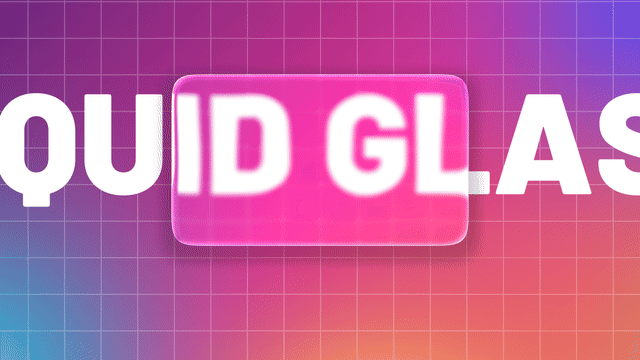

# obs-liquid-glass

Shaders para **OBS Studio** que imitan el efecto de vidrio líquido ("Liquid Glass") de iOS: desenfoque, refracción en el bisel, dispersión de color, tinte, brillo de borde y sombra.




*Simulación aproximada de los shaders con los presets del script / Approximate simulation of the shaders with the script's presets.*

*[English below](#english)*

## Requisitos

- OBS Studio
- Plugin [obs-shaderfilter](https://github.com/exeldro/obs-shaderfilter)

## Shaders

| Archivo | Qué hace |
|---|---|
| `liquid-glass.shader` | Panel de vidrio rectangular con esquinas redondeadas. Posición, tamaño y radio se ajustan con sliders. Para varios paneles, agrega el filtro varias veces. |
| `liquid-glass-forma.shader` | La forma del vidrio la define **otra fuente o escena** (PNG con transparencia, texto, figuras…). Donde esa fuente es opaca (o blanca, en modo brillo) aparece vidrio que refracta la escena. |
| `liquid-glass-lente.shader` | Panel de vidrio con modelo óptico: una placa plana con el canto redondeado. Ver [abajo](#vidrio-con-modelo-óptico-liquid-glass-lenteshader). |

Los shaders de panel y forma tienen versiones en inglés en `en/` y comparten los presets del script. El de lente tiene sus propios controles, solo en español.

## Instalación

1. Descarga los archivos `.shader` (o clona el repo).
2. En OBS, clic derecho sobre la fuente o escena → **Filtros** → **+** → **User-defined shader**.
3. Activa **Load shader text from file** y elige el archivo `.shader`.
4. Ajusta los parámetros.

### Usar una forma personalizada (`liquid-glass-forma.shader`)

1. Crea una escena aparte, por ejemplo "Forma Vidrio", con las figuras donde quieres el vidrio. Esa escena no tiene que salir en vivo.
2. En la escena principal agrega el filtro con `liquid-glass-forma.shader`.
3. En **Fuente de forma** elige la escena "Forma Vidrio".
4. Si tu forma es blanca sobre negro en lugar de tener transparencia, activa **Usar brillo en vez de transparencia**.

**Tip:** el filtro solo refracta lo que hay en la fuente donde se aplica. Para que el vidrio refracte todo lo que está detrás, aplícalo a la escena completa (o a un grupo del tamaño del canvas).

### Vidrio con modelo óptico (`liquid-glass-lente.shader`)

Los otros dos shaders buscan el aspecto de iOS. Este calcula lo que haría un vidrio real: una placa plana apoyada sobre la imagen, con el canto redondeado.

- **Refracción (ley de Snell, índice 1.49 como el acrílico):** en el canto la superficie se inclina y desvía el rayo hacia dentro, como una lupa. El grosor se reduce donde el canto baja, así que el desplazamiento depende del grosor real en cada punto.
- **Imagen en espejo en la orilla:** con vidrio grueso puede aparecer una franja delgada con la imagen invertida. No es un error: el fondo queda más allá del foco del canto, como pasa con un vidrio grueso real. Baja **Grosor del vidrio** si no la quieres.
- **Tinte por absorción (Beer-Lambert):** el color filtra la luz en vez de pintarla encima, y se intensifica donde la luz recorre más vidrio. *Cantidad de tinte* entre 0.3 y 0.5 se nota bien.
- **Reflejo (Fresnel):** el canto refleja la escena que lo rodea (desenfocada); el centro casi no refleja (4%). *Intensidad del reflejo* escala ese reflejo y el brillo de la luz.
- **Dispersión de color:** cada color usa un índice ligeramente distinto. El valor por defecto es unas 3 veces más fuerte que en el acrílico real, para que se aprecie.

| Parámetro | Efecto |
|---|---|
| Centro X/Y, Ancho, Alto (%) | Posición y tamaño del panel, en porcentaje del lienzo |
| Radio de esquinas (px) | Redondeo de las esquinas vistas desde arriba |
| Ancho del bisel (px) | Ancho del canto redondeado |
| Grosor del vidrio (px) | Distancia de la cara de arriba a la imagen: más grosor, más refracción |
| Desenfoque (px) | Esmerilado del vidrio; es menor en el canto para que se vea la refracción |
| Ángulo de la luz | De dónde viene la luz del reflejo especular |
| Ondulación animada | Mueve la superficie (refracción y reflejos juntos) |
| Sombra | Tamaño y opacidad de la sombra proyectada |

Los tamaños en px son absolutos: en un lienzo 4K conviene aumentarlos.

## Parámetros principales

Para `liquid-glass.shader` y `liquid-glass-forma.shader`:

| Parámetro | Efecto |
|---|---|
| Desenfoque | Radio del blur del contenido detrás del vidrio |
| Refracción | Desplazamiento en el bisel; negativo = efecto lupa |
| Ancho del bisel | Qué tan ancha es la zona curva del borde |
| Dispersión de color | Separación RGB en el bisel (aberración cromática) |
| Saturación / Tinte | Color del vidrio |
| Brillo de borde / Ángulo de la luz | Reflejo especular; *Giro de la luz* lo anima |
| Sombra | Opacidad y tamaño de la sombra proyectada |
| Ondulación líquida / Velocidad | Deformación orgánica animada en el vidrio y sus reflejos |
| Grano de escarcha (Frost) | Textura esmerilada sutil y dispersión aleatoria del desenfoque |
| Perfil del bisel | 0 = curva suave; 1 = convexo tipo iOS, comprime el fondo junto a la orilla |
| Tinte en el bisel | 1 = el tinte se desvanece en el borde (clave para vidrio oscuro) |
| Luz del lado opuesto | Brillo en el lado del borde contrario a la luz |
| Forma de esquina | 2 = esquina circular; 4–6 = squircle (esquina continua estilo iOS). Solo en `liquid-glass.shader` |
| Magnificación del interior | Zoom de todo el interior hacia el centro, como lente gruesa (1.03–1.08 es sutil). En `liquid-glass-forma.shader` el centro se elige con *Centro de magnificación X/Y* |
| Suavizado del borde | Ancho de la transición en la orilla, útil a 4K. Solo en `liquid-glass.shader` |

## Presets con botones (script)

`liquid-glass-presets.lua` agrega botones para aplicar estilos tipo iOS. Escribe los valores en el filtro, así que los sliders quedan ajustables.

1. **Herramientas → Scripts → +** y elige `liquid-glass-presets.lua`.
2. En **Filtro de vidrio** elige tu filtro (si no aparece, **Actualizar lista**).
3. Presiona un preset:

| Preset | Inspirado en | Rasgos |
|---|---|---|
| Control | Botones del Centro de control | Casi sin tinte, fondo muy desenfocado, brillo en dos lados |
| Barra oscura | Barra de búsqueda / Siri | Centro casi negro, el bisel deja ver el fondo refractado |
| Panel grande | Carpetas | Desenfoque fuerte, tinte oscuro ligero, bisel fino |
| Objeto grande | Figuras y logos decorativos (400 px o más) | Bisel ancho, refracción fuerte, poco blur: pieza gruesa de vidrio |

También puedes **guardar tus valores actuales** con un nombre y aplicarlos después en otros filtros. Si tenías abiertas las propiedades del filtro, ciérralas y ábrelas de nuevo para ver los sliders actualizados.

## Verificar cambios

Si modificas los shaders o el script, `tools/check.ps1` revisa todo en un paso:

```powershell
pwsh tools/check.ps1                 # compila los shaders, revisa el Lua y que español = inglés
pwsh tools/check.ps1 -SyncTo $HOME   # además, si todo pasa, copia los shaders a esa carpeta
```

Necesita el Windows SDK (por `fxc.exe`) y Node.js. La primera vez instala `luaparse` en `%LOCALAPPDATA%\obs-liquid-glass-check`.

---

## English

Shaders for **OBS Studio** that mimic the iOS "Liquid Glass" look: background blur, bezel refraction, chromatic dispersion, tint, rim highlight and drop shadow.

### Requirements

- OBS Studio
- [obs-shaderfilter](https://github.com/exeldro/obs-shaderfilter) plugin

### Files (English versions in `en/`)

The `en/` folder has the English versions, with English slider labels and comments. The code is identical to the Spanish files in the root, and parameter names are the same, so presets and saved values work with either language.

| File | What it does |
|---|---|
| `en/liquid-glass.shader` | Rounded-rectangle glass panel. Position, size and corner radius are slider controls. Add the filter multiple times for several panels. |
| `en/liquid-glass-shape.shader` | The glass shape comes from **another source or scene** (transparent PNG, text, shapes…). Wherever that source is opaque (or white, in luminance mode) you get glass refracting the scene. |
| `en/liquid-glass-presets.lua` | OBS script with one-click presets (see below). |

The root also has [`liquid-glass-lente.shader`](liquid-glass-lente.shader) (Spanish controls only). Instead of imitating the iOS look, it models a real piece of glass: a flat slab resting on the image with a rounded edge.

- Snell refraction (IOR 1.49, like acrylic) through the curved edge, using the actual local thickness. Thick glass can show a thin mirrored band at the rim, as real glass does when the background is past the edge's focal point; lower **Grosor del vidrio** (glass thickness) to avoid it.
- Tint by absorption (Beer-Lambert): it filters light instead of painting over it, and gets stronger where light travels through more glass. Try **Cantidad de tinte** 0.3–0.5.
- Fresnel reflection of the surrounding (blurred) scene at the edge, about 4% at the flat center.
- Color dispersion about 3× stronger than real acrylic by default, so it's visible.

### Install

1. Download the files in `en/` (or clone the repo).
2. In OBS, right-click a source or scene → **Filters** → **+** → **User-defined shader**.
3. Enable **Load shader text from file** and pick the `.shader` file.
4. Tweak the parameters.

### Custom shape (`en/liquid-glass-shape.shader`)

1. Create a separate scene, e.g. "Glass Shape", containing the shapes you want as glass. It doesn't need to go live.
2. Add the filter with `en/liquid-glass-shape.shader` to your main scene.
3. Set **Shape source** to that scene.
4. If your shape is white-on-black instead of using transparency, enable **Use luminance instead of alpha**.

**Tip:** the filter can only refract what's inside the source it's applied to. To refract everything behind it, apply it to the whole scene (or a canvas-sized group).

### Main parameters

| Parameter | Effect |
|---|---|
| Blur | Blur radius of the content behind the glass |
| Refraction | Bezel displacement; negative = magnifier effect |
| Bezel width | How wide the curved edge zone is |
| Color dispersion | RGB split at the bezel (chromatic aberration) |
| Saturation / Tint | Glass color |
| Rim highlight / Light angle | Specular reflection; *Light rotation* animates it |
| Shadow | Drop shadow opacity and size |
| Liquid wave / Wave speed | Animated organic distortion of the glass and its reflections |
| Frost grain | Subtle frosted texture and randomized blur scattering |
| Bezel profile | 0 = soft curve; 1 = iOS-like convex, squeezes the background at the rim |
| Bezel tint | 1 = tint fades out at the edge (key for dark glass) |
| Back light | Highlight on the rim side facing away from the light |
| Corner shape | 2 = circular corner; 4–6 = squircle (iOS-style continuous corner). `liquid-glass.shader` only |
| Interior magnification | Zooms the whole interior toward the center, like a thick lens (1.03–1.08 is subtle). In `liquid-glass-shape.shader` you pick the center with *Magnification center X/Y* |
| Edge feathering | Width of the edge transition, useful at 4K. `liquid-glass.shader` only |

### Presets with buttons (script)

`en/liquid-glass-presets.lua` adds one-click iOS-style presets. It writes the values into the filter, so the sliders stay adjustable.

1. **Tools → Scripts → +** and pick `en/liquid-glass-presets.lua`.
2. Choose your filter under **Glass filter** (use **Refresh list** if it's missing).
3. Click a preset:

| Preset | Based on | Look |
|---|---|---|
| Control | Control Center buttons | Almost no tint, heavily blurred background, highlight on two sides |
| Dark bar | Search bar / Siri | Near-black center; the bezel shows the refracted background |
| Large panel | Folders | Strong blur, light dark tint, thin bezel |
| Large object | Decorative shapes and logos (400 px+) | Wide bezel, strong refraction, little blur: a thick piece of glass |

You can also save your current values under a name and reuse them on other filters. If the filter's properties window was open, reopen it to see the updated sliders.

### Checking changes

If you edit the shaders or the script, `tools/check.ps1` checks everything in one step: it compiles the 5 shaders with `fxc`, checks the Lua syntax, and verifies that the Spanish and English code is identical apart from comments and strings. With `-SyncTo <folder>` it also copies the shaders there when everything passes. It needs the Windows SDK and Node.js; the first run installs `luaparse` into `%LOCALAPPDATA%\obs-liquid-glass-check`.

## Licencia / License

[MIT](LICENSE)

*Inspirado en el diseño Liquid Glass de Apple. Proyecto independiente, sin relación con Apple Inc. / Inspired by Apple's Liquid Glass design. Independent project, not affiliated with Apple Inc.*
